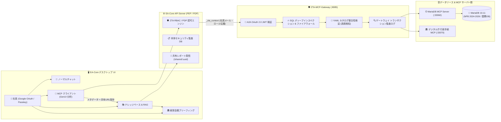

# 🛡️ EmployeeAgent-Core (EA-Core v1.0.0)

**Zero Trust Architecture (ZTA) 準拠・エンタープライズ AI エージェント デスクトップ OS & MCP データ分析プラットフォーム**

[](./CHANGELOG.md)
[-emerald.svg)](#1-ea-core-とは何か--ea-core-でできること)
[](#3-同梱-mcp-サンプルデータnpb-プロ野球--デジタル庁-行政手続データ)

**EmployeeAgent-Core (`EA-Core`)** は、企業内のデータベース・業務システム・社内ナレッジを **Zero Trust Architecture (ZTA)** の厳格なガバナンス下で AI エージェント（Google Gemini / Anthropic Claude / ローカル LLM Gemma 4）と安全に接続し、自然言語によるデータ分析・インタラクティブ可視化（GenUI ダッシュボード生成）・経営会議ブリーフィングまでを一貫して行える Web デスクトップ OS 環境です。

本リポジトリには **EA-Core 本体** に加え、**ZTA-MCP-Gateway（SQL ファイアウォール＆データカタログ整合性検証プロキシ）** およびすぐに試せる **2種類の公式サンプル MCP サーバー（NPB プロ野球 2024〜2026 公式戦 MariaDB & デジタル庁 行政手続等棚卸調査データ）** が同梱されており、Fork / Clone して **1コマンド** でフルスタック環境を体験できます。

---

## 📑 目次

1. [EA-Core とは何か / EA-Core でできること](#1-ea-core-とは何か--ea-core-でできること)
2. [ウィジェット単位での段階的な機能拡張アーキテクチャ](#2-ウィジェット単位での段階的な機能拡張アーキテクチャ)
3. [同梱 MCP サンプルデータ（NPB プロ野球 & デジタル庁 行政手続データ）](#3-同梱-mcp-サンプルデータnpb-プロ野球--デジタル庁-行政手続データ)
4. [システム要件と MariaDB について](#4-システム要件と-mariadb-について)
5. [ローカル PC で Fork / Clone してテストする方法（クイックスタート）](#5-ローカル-pc-で-fork--clone-してテストする方法クイックスタート)
6. [さくらインターネット VPS へのデプロイ手順](#6-さくらインターネット-vps-へのデプロイ手順)
7. [AWS (EC2) へのデプロイ手順](#7-aws-ec2-へのデプロイ手順)
8. [初期 Activation（アクティベーション）の仕方とソフトウェアのアップデート（VUP）方法](#8-初期-activationアクティベーションの仕方とソフトウェアのアップデートvup方法)

---

## 1. EA-Core とは何か / EA-Core でできること

企業の AI 導入において最大の障壁となる「**AI が社内 DB にどんな SQL を投げたか分からない**」「**権限のない社員が AI 経由で機密テーブルを参照してしまう**」「**分析結果がその場限りで流れてしまい全社ナレッジにならない**」という課題を、OS レベルの UI と ZTA ゲートウェイの統合によって解決します。



### 主な機能

1. **🔌 ZTA 準拠 MCP クライアント & GenUI インタラクティブダッシュボード自動生成**
   - 自然言語で分析指示を出すだけで、AI が MCP サーバー経由で DB から実データを抽出し、Tailwind CSS + Chart.js による**タブ切り替え・クリック連動型のインタラクティブ HTML ダッシュボード（GenUI）**を自動生成します。
   - **ZTA 厳格データ分離**: システムプロンプトにはスキーマ定義（テーブル名・カラム名）のみを保持し、実データ数値は一切含めません。権限がない場合や DB 未接続時に AI がプロンプト知識から数値を捏造・漏洩することを防ぎます。
2. **🛡️ ZTA-MCP-Gateway による SQL 監査・ファイアウォール・逸脱検知（エンドユーザー完全追跡）**
   - すべての MCP 通信は OAuth 2.0 (`Client Credentials` + JWT) および SSE (`GET /sse`, `POST /message`) で保護されます。
   - **社員メールアドレス単位の監査証跡**: A2A クライアント ID（`macosui-analyst` 等）だけでなく、**実際に画面を操作した社員のメールアドレス（`user_email`）・ユーザー ID・ロール**をゲートウェイ監査ログまで一気通貫で記録します。
   - **SQL ディープインスペクション & カタログ逸脱検知**: AI が発行した SQL 全文、対象テーブル、参照カラム、実行時間（ms）を記録し、YAML カタログのホワイトリストに未定義のテーブルへアクセスした場合は **「⚠️ 逸脱検知 (`UNDEFINED_TABLE_ACCESS`)」** としてリアルタイムに警告表示します。
3. **📚 ナレッジベース（RAG）& 経営会議ブリーフィング連携**
   - MCP クライアントで生成したダッシュボードや分析レポートは、ワンクリックで **プロンプト・使用 AI モデル・消費トークン数（Input/Output/Total）・EA 内共有 URL（`/shared/:uuid`）** のメタデータヘッダー付きでナレッジベースや経営会議アジェンダへ登録できます。
4. **🔐 エンタープライズ認証・セッションハイジャック検知・無操作タイムアウト**
   - Google OAuth 2.0 および WebAuthn（Passkey / 生体認証）による 2 段階認証、IP/User-Agent 変化によるセッションハイジャック検知、30分無操作による ZTA 自動セッション失効を搭載しています。

---

## 2. ウィジェット単位での段階的な機能拡張アーキテクチャ

EA-Core は、最初は最小限のシンプルな構成（**基本 4 ウィジェット**）からスタートし、組織の習熟度や用途に合わせて **後からウィジェットごとにプラグイン形式で機能拡張（アドオン追加）** できるモジュラー設計（`Widget Registry & Capability Bus`）を採用しています。

| 区分 | ウィジェット名 | パッケージ ID | 概要・拡張時の連携動作 |
| :--- | :--- | :--- | :--- |
| **基本パック標準搭載 (Core 4)** | **💬 ノーマルチャット** | `com.techies.widget.normal-chat` | 日常の対話・壁打ち用 AI チャット。ナレッジベースと自動連携し社内規定・過去レポートを参照（RAG）可能。 |
| **基本パック標準搭載 (Core 4)** | **🔌 MCP クライアント** | `com.techies.widget.mcp-client` | ZTA ゲートウェイ経由で社内 DB・業務 MCP を分析し、GenUI ダッシュボードを生成。 |
| **基本パック標準搭載 (Core 4)** | **📚 ナレッジ＆RAG** | `com.techies.widget.knowledge-rag` | 分析結果や社内ドキュメントを蓄積。トークン消費量や著者別投稿数のクロス集計 MCP ツールも内蔵。 |
| **基本パック標準搭載 (Core 4)** | **🏛️ 経営会議ブリーフィング** | `com.techies.widget.meeting-briefing` | MCP や Deep Research で作成した HTML ダッシュボードを会議アジェンダとして登録・プレゼン表示。 |
| **拡張ウィジェット (Add-on)** | **🔬 Deep Research** | `com.techies.widget.deep-research` | Web 最新検索と社内 RAG を融合した長文調査レポート＋インフォグラフィック＋HTML 自動生成ワークフロー。 |
| **拡張ウィジェット (Add-on)** | **🏢 バーチャルオフィス** | `com.techies.widget.virtual-office` | 社員のリアルタイム在席状況（Focus / Meeting / Remote / Offline）と不在時 AI 秘書による日程調整。 |
| **拡張ウィジェット (Add-on)** | **📅 カレンダー / 🌐 ブラウザ / 📝 付箋 / 🧮 電卓** | `com.techies.widget.*` | System Settings の「🧩 ウィジェット管理 (Widget Store)」からワンクリックで有効化・無効化が可能。 |

> [!TIP]
> 独自の社内業務ウィジェットを追加したい場合も、[server/services/widgetRegistryService.cjs](./server/services/widgetRegistryService.cjs) のマニフェスト定義と RBAC ポリシー（PDP）に従うだけで、ハードコードなしに Dock・権限管理画面・AI モデルルーティングへ自動統合されます。

---

## 3. 同梱 MCP サンプルデータ（NPB プロ野球 & デジタル庁 行政手続データ）

Fork / Clone した直後から MCP による高度なデータ分析・GenUI ダッシュボード生成・SQL 監査ログを試せるよう、以下の **2つの実用サンプル MCP データセット** が標準同梱されています。

### ① ⚾ NPB プロ野球公式戦データベース（2024〜2026年 マルチ年度データ / MariaDB）
- **収録テーブル**:
  - `players`（選手マスタ: 70名）
  - `teams`（セ・パ12球団マスタ）
  - `team_standings`（2024・2025・2026年 シーズン確定順位表: 36レコード）
  - `batting_stats`（2024〜2026年 主力野手成績・WAR/WAA・OPS・タイトル表彰: 45レコード）
  - `pitching_stats`（2024〜2026年 主力投手成績・防御率・WHIP・K数・タイトル表彰: 33レコード）
  - `games`（日本シリーズ・CSファイナル・交流戦等の直接対決スコア＆責任投手履歴: 16レコード）
- **試せる定型プロンプト例（MCP クライアント画面にプリセット済）**:
  - *「2025年阪神タイガース優勝の立役者（2024 vs 2025 投打総合・戦力進化ダッシュボード）」*
  - *「2026年日本シリーズ（ソフトバンク vs DeNA）戦力徹底比較」*

### ② 🏛️ デジタル庁 行政手続等の棚卸調査データ（令和6・7年度 約7.6万件）
- **概要**: 全国38府省庁・約76,275件の行政手続に関するオンライン化実施状況、年間手続件数、国民のライフイベント（死亡・相続、引越し、出生等）別分類、および紙原本（戸籍・住民票・印鑑証明等）の添付義務状況を高速集計（Polars エンジン）する MCP サーバーです。
- **試せる定型プロンプト例**:
  - *「行政手続・ライフイベント別デジタル化＆行政改革ダッシュボード」*
  - *「紙原本（戸籍・住民票）添付義務の手続き分析」*

---

## 4. システム要件と MariaDB について

### 必須ソフトウェア要件
- **Docker Engine** (v24.0 以上) & **Docker Compose** (v2.20 以上)
- **MariaDB 10.11 以上**
  - **NPB サンプルデータおよび SQL ファイアウォール検証には MariaDB が必要です。**
  - 本リポジトリのフルスタック構成（[`docker-compose.full.yml`](./docker-compose.full.yml) または [`zta-mcp-stack/docker-compose.sample.yml`](./zta-mcp-stack/docker-compose.sample.yml)）を使用すると、**公式 `mariadb:10.11` コンテナが自動起動し、初期データ（[`scripts/setup_npb_data.sql`](./scripts/setup_npb_data.sql)）も自動投入される**ため、ホスト OS 側へ個別に MariaDB をインストールする必要はありません。
  - 既存の社内 MariaDB / MySQL サーバーに接続したい場合は、`zta-mcp-stack/docker-compose.sample.yml` の `mariadb-mcp` 環境変数（`DB_HOST`, `DB_PORT`, `DB_USER`, `DB_PASSWORD`, `DB_NAME`）を変更するだけで接続先を切り替えられます。

### 事前準備する API キー / クレデンシャル
1. **Google Cloud OAuth 2.0 クライアント ID & シークレット**（初回 Activation 画面で登録します）
   - Google Cloud Console の「承認済みの JavaScript 生成元」に `http://localhost:8080`（本番・VPS の場合は `https://あなたのドメイン`）を追加してください。
2. **Gemini API Key**（Google AI Studio）または **Claude API Key**（Anthropic Console）
   - Activation 完了後、画面内の「System Settings」から GUI で安全に暗号化保存できます（コードや Git に API キーを含める必要はありません）。

---

## 5. ローカル PC で Fork / Clone してテストする方法（クイックスタート）

Mac / Windows (WSL2) / Linux のローカル PC 上で、**EA-Core + ZTA-MCP-Gateway + MariaDB (NPB) + デジタル庁 MCP** のフルスタック環境を 1 コマンドで起動できます。

### Step 1: リポジトリの Fork & Clone
GitHub 上で本リポジトリを **Fork** し、ローカル PC に Clone します。

```bash
git clone https://github.com/<あなたのGitHubアカウント>/EmployeeAgent-Core.git
cd EmployeeAgent-Core
```

### Step 2: フルスタック起動スクリプトの実行
以下のスクリプトを実行すると、暗号化キー（`server/development.env`）の自動生成、全 5 コンテナのビルド・起動、および MariaDB への NPB データ投入までが自動で行われます。

```bash
bash scripts/start-local.sh
```

> **補足**: ZTA-MCP-Gateway や MariaDB を含めず、EA-Core 本体のみを単体起動したい場合は `bash scripts/start-local.sh --core-only` を実行してください。

### Step 3: 動作確認URL
起動完了後、以下の URL にアクセスできます。

| サービス | ローカル URL | 説明 |
| :--- | :--- | :--- |
| **EA-Core デスクトップ画面** | http://localhost:8080 | ブラウザで開くと初回 Activation 画面が表示されます |
| **EA-Core ヘルスチェック** | http://localhost:8080/api/health | `{"status":"ok","message":"Server is running"}` |
| **ZTA-MCP-Gateway ヘルスチェック** | http://localhost:8085/healthz | `{"status":"healthy","version":"1.0"}` |
| **MariaDB (NPB DB)** | `localhost:3306` | DB名: `testdb` / User: `testuser` / Pass: `testpassword` |

---

## 6. さくらインターネット VPS へのデプロイ手順

さくらインターネットの VPS（Debian / Ubuntu 推奨、メモリ 2GB 以上）へ、ローカル PC からセキュアにフルスタック一括デプロイするスクリプト（[`scripts/deploy-staging.sh`](./scripts/deploy-staging.sh)）を用意しています。

### Step 1: さくら VPS 側の初期セットアップ（初回のみ）
1. お名前.com 等の DNS で、ドメイン（例: `ea-demo.example.com`）の A レコードをさくら VPS の IP アドレスに向けます。
2. さくら VPS のパケットフィルターで **SSH (22)**、**HTTP (80)**、**HTTPS (443)** を開放します。
3. VPS 上に Docker & Docker Compose をインストールし、Let's Encrypt 証明書を配置します（[`scripts/setup-vps.sh`](./scripts/setup-vps.sh) および [`scripts/get-letsencrypt.sh`](./scripts/get-letsencrypt.sh) が利用可能です）。

### Step 2: ローカル PC から 1 コマンドデプロイ実行
ローカル PC 上で、接続先ホスト名・ユーザー名・SSH 秘密鍵パスを指定して [`scripts/deploy-staging.sh`](./scripts/deploy-staging.sh) を実行します。

```bash
STAGING_VPS_HOST=" your-domain.example.com " \
STAGING_VPS_USER="debian" \
STAGING_SSH_KEY="$HOME/.ssh/id_ed25519_vps" \
bash scripts/deploy-staging.sh
```

#### このスクリプトが自動実行する処理（Built-in Quality パイプライン）
1. **脆弱性診断**: `npm audit --audit-level=critical` および `docker scout cves` で CRITICAL 脆弱性が 0 件であることを検証。
2. **マルチアーキテクチャビルド (`linux/amd64`)**: Apple Silicon (M1/M2/M3/M4) Mac からでも x86_64 のさくら VPS 用イメージ（`EA-Core`, `ZTA-MCP-Gateway`, `MariaDB-MCP`, `Admin-Procedures-MCP`）を高速ビルドして圧縮転送。
3. **MariaDB 自動起動 & NPB データ投入**: VPS 上で `test_mariadb` コンテナを起動し、2024〜2026 NPB 公式戦データを自動投入。
4. **永続 DB の自動バックアップ & コンテナ更新**: 既存の `database.sqlite` がある場合は自動で世代バックアップを取得した上で Web & Nginx コンテナを再起動。

---

## 7. AWS (EC2) へのデプロイ手順

AWS EC2（Amazon Linux 2023 または Ubuntu 22.04/24.04、EBS 永続ボリューム `/app/data` マウント構成推奨）向けのデプロイ＆アップデートスクリプト（[`scripts/deploy-ec2.sh`](./scripts/deploy-ec2.sh)）を用意しています。

### Step 1: EC2 インスタンスの準備（初回のみ）
1. EC2 インスタンスを作成し、セキュリティグループで **80 / 443**（または ALB 経由で **8080**）と **22 (SSH)** を許可します。
2. 永続データ保護用のディレクトリ（推奨: `/app/data`）を作成し、リポジトリを `/opt/macosui/repo` に Clone します。

```bash
sudo mkdir -p /app/data /opt/macosui
sudo chown -R $(whoami):$(whoami) /app/data /opt/macosui
git clone https://github.com/<あなたのGitHubアカウント>/EmployeeAgent-Core.git /opt/macosui/repo
```

### Step 2: デプロイスクリプトの実行
EC2 インスタンス上で以下のコマンドを実行すると、`/app/data` のシンボリックリンク保護・暗号化キー自動生成・`EA-Core + ZTA-MCP-Gateway + MariaDB (NPB) + デジタル庁 MCP` の全コンテナ起動と NPB データ投入が完了します。

```bash
cd /opt/macosui/repo
bash scripts/deploy-ec2.sh
```

---

## 8. 初期 Activation（アクティベーション）の仕方とソフトウェアのアップデート（VUP）方法

### 🔑 初回 Activation（システム初期セットアップ）の手順
新規インストール直後（データベースが空の状態）にブラウザでアクセスすると、自動的に **「System Activation（初期セットアップ）」画面** が表示されます。

1. **Google OAuth クレデンシャルの入力**
   - 画面の入力欄に Google Cloud Console で発行した **`Google Client ID`** と **`Google Client Secret`** を入力します。
2. **初期管理者（Admin）アカウントでの Google ログイン**
   - Google ログインボタンを押して認証すると、**最初にログインしたユーザーが自動的にシステム全体の最高管理者（`admin` ロール）として登録**されます。
3. **AI API キー（Gemini / Claude）の登録**
   - デスクトップ画面が開いたら、上部メニューバーまたは Dock から **「⚙️ System Settings」** を開きます。
   - **「🔑 API & AI モデル設定」** タブで `Gemini API Key`（および必要に応じて `Claude API Key`）を入力して「保存」をクリックします（API キーは `DB_ENCRYPTION_KEY` により AES-256-GCM で暗号化されて DB に保存されます）。
4. **MCP クライアントでの分析テスト**
   - Dock の **「🔌 MCP クライアント」** を開き、上部の定型プロンプトボタン（例: `2026年日本シリーズ（ソフトバンクvsDeNA）戦力徹底比較` や `行政手続・ライフイベント別デジタル化ダッシュボード`）をクリックして実行してください。
   - 実行後、**「⚙️ System Settings」 ➔ 「🛡️ セキュリティ監査ログ」 ➔ 「🌐 ZTA Gateway 監査」** を開くと、あなたのメールアドレス・発行された SQL・参照テーブル・カタログ整合性判定が記録されていることを確認できます。

---

### 🔄 ソフトウェアのアップデート（VUP）方法（Zero Data Loss 原則）

> [!IMPORTANT]
> **一度 Activation を完了した環境では、バージョンアップ（VUP）時に Activation をやり直す必要はありません。**
> 登録済みのユーザー、暗号化された API キー、ナレッジベース記事、監査ログはすべて SQLite データベース（`data/database.sqlite` または `server/database.sqlite`）に永続化されており、以下の手順でデータを 1 件も失わずに最新コードへアップデートできます。

#### ローカル PC 環境のアップデート手順
```bash
git pull origin main
bash scripts/start-local.sh
```

#### さくらインターネット VPS 環境のアップデート手順
ローカル PC で最新コードを pull（または改修）した後、デプロイスクリプトを再実行するだけです。スクリプト内で自動的にリモート DB の世代バックアップ（`database_backup_YYYYMMDD_HHMMSS.sqlite`）を作成した上でコンテナのみを最新イメージに入れ替えます。
```bash
bash scripts/deploy-staging.sh
```

#### AWS EC2 環境のアップデート手順
EC2 上で [`scripts/deploy-ec2.sh`](./scripts/deploy-ec2.sh) を実行すると、`/app/data/database.sqlite` の自動バックアップ取得 ➔ `git pull origin main` ➔ コンテナ再ビルド＆再起動 ➔ 既存ユーザーデータの生存検証までが自動で行われます。
```bash
cd /opt/macosui/repo
bash scripts/deploy-ec2.sh
```

---

## 📄 ライセンス・ドキュメント

- 変更履歴: [CHANGELOG.md](./CHANGELOG.md)
- ZTA-MCP-Gateway 仕様詳細: [zta-mcp-stack/README.md](./zta-mcp-stack/README.md)
