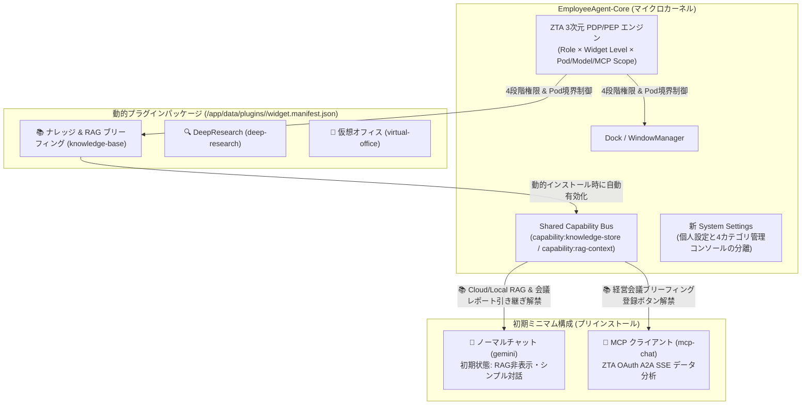

# EmployeeAgent-Core 実装ウォークスルー (`Techies-T/EmployeeAgent-Core`)

本ドキュメントでは、モノリシック構成だった `Employee Agent` をマイクロカーネル＋動的プラグイン構造（案B & Shared Capability Bus）へ刷新し、システム管理コンソール（System Settings）の再編成および ZTA 3次元権限マトリクス（PDP/PEP）を実装した内容をまとめます。

---

## 1. 全体アーキテクチャとデータフロー

> [!IMPORTANT]
> **初期ミニマム構成の徹底**: 初期状態では Core OS（`settings`）と `gemini`（ノーマルチャット）、`mcp-chat`（MCPクライアント）の2ウィジェットのみがインストールされており、RAGやナレッジが未導入の環境ではチャット画面からRAG選択肢が自動的に隠蔽されます。

---

## 2. 実装ファイル一覧と主要な変更点

### 2.1 バックエンド（プラグイン管理・Shared Capability Bus・ZTA PDP v2）

| コンポーネント | ファイル | 実装内容 |
| :--- | :--- | :--- |
| **Plugin Manager** | `server/services/pluginManager.cjs` | ・初期ミニマム構成（`gemini`, `mcp-chat`）と全12種のウィジェットカタログ定義 ・`DATA_DIR/plugins/<id>/widget.manifest.json` への物理マニフェスト出力（案B） ・インストール済みプラグインに応じた `capabilities`（Shared Capability Bus）の動的算出 ・14日間無料トライアル管理および HMAC-SHA256 ライセンスキー（`EA-LIC-...`）の発行・署名検証 |
| **ZTA PDP Service** | `server/services/ztaPdpService.cjs` | ・`none`（不可）/ `read`（参照のみ）/ `execute`（実行・作成）/ `manage`（管理）の4段階権限レベル管理 ・Pod別の `read` / `write` スコープ、許可AIモデル、許可MCPサーバーの3次元ポリシー管理と既存 `RBAC_POLICIES` への双方向コンパイル ・経営会議向けの3ロールプリセット（`exec_planner`, `domain_leader`, `general_member`） |
| **Core Plugin API** | `server/routes/corePlugins.cjs` | ・`/api/core/plugins`（一覧・install・uninstall・reset-minimum・generate-license） ・`/api/core/ai-routing`（ウィジェット別AIモデル割当の一括取得・保存） ・`/api/core/pdp`（ZTA 3次元ポリシーの取得・保存・ロールプリセット適用） |
| **Server Entry** | `server/index.cjs` | ・`/api/core` ルートのマウント ・`GET /api/config` に `installedWidgets`, `availableAddons`, `capabilities` を統合 ・`GET /api/auth/me` に ZTA PDP 評価済みの `widget_levels`, `pod_scopes` を統合 |

---

### 2.2 フロントエンド：新 System Settings（個人設定と管理コンソールの分離）

| タブ / 画面 | ファイル | 実装内容 |
| :--- | :--- | :--- |
| **System Settings 本体** | `src/apps/SystemSettings.jsx` | サイドバーを一般ユーザー向けの **「👤 マイ設定 (個人用)」** と、管理者専用の **「🛠️ システム管理コンソール」** に分離。 |
| **Cat 1: AI Hub** | `src/apps/SystemSettings/tabs/AiHubTab.jsx` | ・**上段（共通AIクレデンシャルプール）**: Gemini API Key、Claude API Key、Local AI エンドポイントを一元設定 ・**下段（ウィジェット別AIモデル割当マトリクス）**: インストール済みウィジェットごとに「どのプロバイダー（Gemini / Claude）のどのモデルを使うか」を1つの表で一覧・即時変更 |
| **Cat 2: ウィジェット管理 & ストア** | `src/apps/SystemSettings/tabs/WidgetStoreTab.jsx` | ・**上段（インストール済み管理）**: 稼働中ウィジェット一覧と、各ウィジェット固有の「⚙️ 個別設定モーダル」（MCP接続管理、チャットプリセット設定等をカプセル化） ・**下段（アドオンカタログ）**: 未導入ウィジェットの提案表示、「🎁 14日間無料トライアル開始」、「🔑 ライセンスキー認証導入」、および「初期ミニマム構成へリセット」機能 |
| **Cat 3: ZTA 権限マトリクス (PDP)** | `src/apps/SystemSettings/tabs/ZtaPolicyMatrixTab.jsx` | ・**第1階層（シンプルマトリクス）**: `ロール × インストール済みウィジェット` の4段階権限バッジ切替と経営会議ロールプリセット一括適用 ・**第2階層（詳細スコープ設定モーダル）**: セルをクリックして Pod別の参照/書込スコープ、許可AIモデル、許可MCPサーバーを細粒度に制御 |

---

### 2.3 経営会議・事前ブリーフィング連携シナリオの動作フロー

1. **全社まとめ分析の登録（営業管理・経営企画 `exec_planner`）**:
   - `src/apps/McpChat.jsx` で 2026年第1四半期（Q1）の売上見込みを MCP 経由で分析。
   - `knowledge-base` プラグイン導入時に表示される **「📚 経営会議ブリーフィング（ナレッジ）に登録」** ボタンから、分析レポート・ダッシュボードを全社/経営会議 Pod へ事前共有。
2. **会議前の事前閲覧と単一ドメイン深掘り引き継ぎ（各事業部門長 `domain_leader`）**:
   - `src/apps/KnowledgeBase.jsx` で事前共有された全社まとめレポートを閲覧。
   - 記事ヘッダーの **「📊 経営会議・事前ブリーフィング引き継ぎ (Shared Capability Bus)」** バーから以下のいずれかをクリック：
     - **「💬 チャットで深掘り・AI壁打ち」** → `src/apps/Gemini.jsx` が起動し、`📊 経営会議ブリーフィング参照中` バナーと深掘りワンクリックプロンプト（「💡 単一ドメイン課題 & Q2投資判断のAI壁打ち」「📋 経営会議のアジェンダ・論点抽出」）がセットされた状態でAI壁打ちを開始。
     - **「🔌 MCPで単一ドメイン深掘り分析」** → `src/apps/McpChat.jsx` が起動し、全社まとめレポートの文脈を引き継いだまま自部門ドメインのMCP実データを深掘り照会。

---

## 3. 組み込み品質検証 (Built-in Quality) エビデンス

| 検証項目 | 実行コマンド | 結果 |
| :--- | :--- | :--- |
| **バックエンド構文検証** | `node -c server/index.cjs server/services/pluginManager.cjs server/services/ztaPdpService.cjs server/routes/corePlugins.cjs` | **PASS (構文エラー 0件)** |
| **フロントエンド Lint & ビルド** | `npm run build` (`eslint . && vite build`) | **PASS (ビルド成功・エラー 0件)** |
| **脆弱性監査** | `npm audit --audit-level=critical` | **PASS (CRITICAL 脆弱性 0件)** |
| **Plugin & ZTA PDP スモークテスト** | `getFullPluginCatalog()` / `generateWidgetLicenseKey()` / `hydrateAllPolicies()` | **PASS (ミニマム構成2件・アドオン10件・ライセンス署名検証を確認)** |
