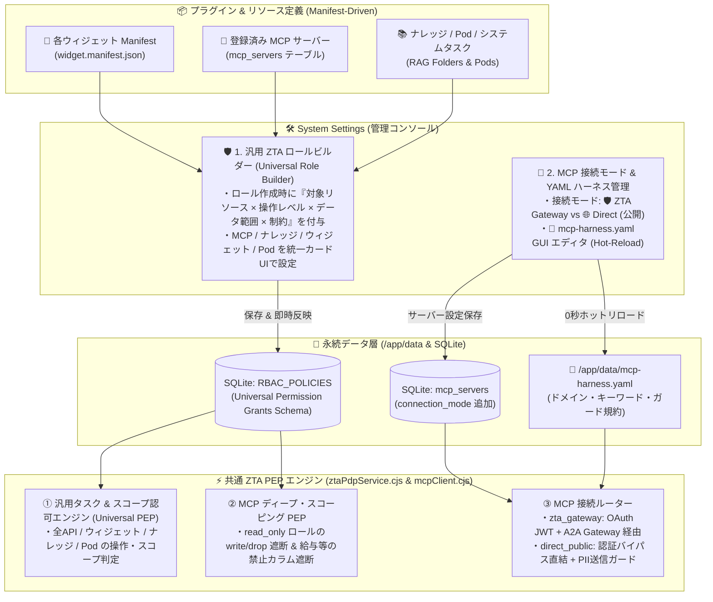

# ZTA 汎用ロール定義型権限ビルダー (Universal Role Builder) & MCP 動的ハーネス 実装計画書

- **対象リポジトリ**: `Techies-T/EmployeeAgent-Core` ([MacOSUI](file:///Users/minoru_inui/AI%20coder/MacOSUI) / [MacOSUI-oss](file:///Users/minoru_inui/AI%20coder/MacOSUI-oss))
- **ドキュメント保存先**:
  - アーティファクト: `implementation_plan.md`
  - リポジトリ内永続ドキュメント: [docs/zta_role_builder_and_mcp_harness_plan.md](file:///Users/minoru_inui/AI%20coder/MacOSUI/docs/zta_role_builder_and_mcp_harness_plan.md)
- **ステータス**: v1.1（MCP 特化ではなく、将来の全ウィジェット・業務タスク・データ空間を統一的に扱う **Universal Resource-Capability-Scope モデル** として定義）

---

## 1. 設計方針：MCP 特化ではなく「将来の全ウィジェット・業務タスク」を見越した汎用設計か？

**結論：最初のインプリメンテーションから、MCP 専用（ハードコード）ではなく、将来追加されるあらゆるウィジェット・業務タスク・データ空間を同一の仕組みで制御できる「汎用リソース・スコープ権限モデル（Universal Permission Grant Model）」として実装します。**

### なぜ最初から汎用モデル（Universal Model）にするのか？
「誰が（Role）」「どの対象に対して（Resource）」「どの操作・タスクまで実行でき（Operation Level）」「どのデータ範囲まで見られるか（Data Scope）」という構造は、MCP サーバーだけでなく以下のすべての業務機能で共通して必要になるためです。

| リソース種別 (`resource_type`) | 具体例 (`resource_id`) | ロールによる権限・スコープの分け方の例 |
| :--- | :--- | :--- |
| **🔌 ① MCP データソース**<br/>(`mcp_server`) | `人事データベース MCP`<br/>`売上・ERP MCP` | ・**人事部ロール**: 操作=`read_write`（更新可） / 範囲=`all_company`（全社・給与含む）<br/>・**部長ロール**: 操作=`read_only`（参照のみ） / 範囲=`department_pod`（自部門のみ・給与除外） |
| **📚 ② ナレッジ & RAG 空間**<br/>(`knowledge_space`) | `経営会議ブリーフィング`<br/>`社内規程・労務RAG` | ・**経営企画ロール**: 操作=`read_write`（全社サマリーの登録・公開可） / 範囲=`all_company`<br/>・**事業部長ロール**: 操作=`execute`（閲覧＋AI壁打ち深掘りのみ） / 範囲=`department_pod` |
| **🧩 ③ 拡張ウィジェット・業務タスク**<br/>(`widget`) | `DeepResearch`<br/>`バーチャルオフィス`<br/>*(将来の経費精算・稟議等)* | ・**リサーチャーロール**: 操作=`read_write`（外部Web調査の実行＋レポート共有）<br/>・**一般社員ロール**: 操作=`read_only`（共有済みレポートの閲覧のみ・実行不可） |
| **🏢 ④ 組織 Pod・データ空間**<br/>(`organization_pod`) | `第一営業部 Pod`<br/>`経営戦略室 Pod` | ・**Pod リーダーロール**: 操作=`admin`（メンバー管理・Pod内データの読み書き）<br/>・**他部門連携ロール**: 操作=`read_only`（公開ボードの参照のみ） |
| **⚙️ ⑤ コア管理・ガバナンス**<br/>(`system_governance`) | `AIモデルルーティング`<br/>`ZTA監査ログ` | ・**システム管理者**: 操作=`admin`（APIキー・モデル割当変更可）<br/>・**セキュリティ監査役**: 操作=`read_only`（ZTA監査ログとポリシーの閲覧のみ・変更不可） |

さらに、プラグインストアから将来新しいウィジェット（`widget.manifest.json`）を追加した際、マニフェスト内にそのウィジェット固有のタスク権限（`permissionsSchema`）を宣言しておくだけで、**権限ビルダー画面のコードを一切改修することなく、自動的に新しいウィジェットの権限・スコープ設定項目が UI に出現するプラグイン連動型（Manifest-Driven）** とします。

---

## 2. アーキテクチャ全体像



---

## 3. フェーズ別 詳細設計

### Phase 1: 汎用ロール定義型 ZTA 権限ビルダー（Universal Role Builder）

チェックボックスのマトリックス画面（および [RolesTab.jsx](file:///Users/minoru_inui/AI%20coder/MacOSUI/src/apps/SystemSettings/tabs/RolesTab.jsx) のレガシー RBAC 画面）を廃止・統合し、**「ロールを選択・作成し、そのロールに対して汎用権限モジュール（Permission Grants）を付与する」** 2ペイン構造のロールビルダー画面へ刷新します。

#### 1.1 汎用権限データスキーマ（`PermissionGrant` 統一フォーマット）
すべての権限ルールを以下の共通構造（`grants` 配列）で表現し、保存時に既存の `allowed_widgets`, `allowed_actions`, `allowed_models`, `allowed_pods` へも自動コンパイルすることで、既存コードとの100%の後方互換性を保ちます。

```json
{
  "hr_mcp_dept_mgr": {
    "label": "📋 人事データ＆組織マネジメント（部長用ロール）",
    "description": "各事業部の部長向け。自部門メンバーの人事データ参照、経営ブリーフィングのAI壁打ち、自部門Podの管理が可能。",
    "category": "domain_leader",
    "grants": [
      {
        "id": "grant_1",
        "resource_type": "mcp_server",
        "resource_id": "mcp:hr_db",
        "resource_label": "人事データベース MCP",
        "operation_level": "read_only",
        "data_scope": "department_pod",
        "constraints": {
          "server_name_match": "人事|hr|personnel",
          "blocked_tools": ["write_query", "drop_table", "update_salary", "delete_record"],
          "restricted_identifiers": ["salary", "bonus", "compensation", "my_number"],
          "scope_prompt_guard": "ログインユーザーの所属部門（Pod）に属する社員データのみを検索対象とし、給与・賞与カラムは参照しないでください。"
        }
      },
      {
        "id": "grant_2",
        "resource_type": "widget",
        "resource_id": "knowledge-base",
        "resource_label": "📚 ナレッジ & RAG ブリーフィング",
        "operation_level": "execute",
        "data_scope": "department_pod",
        "constraints": {
          "allowed_tasks": ["view_briefing", "ai_wall_bouncing_chat", "attach_rag_context"],
          "blocked_tasks": ["publish_company_wide_summary", "delete_official_doc"]
        }
      },
      {
        "id": "grant_3",
        "resource_type": "organization_pod",
        "resource_id": "USER_ASSIGNED_POD",
        "resource_label": "🏢 所属事業部 Pod",
        "operation_level": "read_write",
        "data_scope": "department_pod",
        "constraints": {}
      }
    ]
  }
}
```

#### 1.2 4つの共通軸（どの権限タスクでも同じ UI 操作で設定可能）
管理者がロールに権限を追加する際、対象が MCP であっても、ナレッジであっても、将来の新ウィジェットであっても、常に以下の **4ステップの統一フォーム** で迷わず設定できます：

1. **Step A：対象カテゴリ (`resource_type`) を選ぶ**
   - `🧩 ウィジェット / アプリ機能`
   - `🔌 MCP サーバー / 外部データソース`
   - `📚 ナレッジベース / Google Drive RAG フォルダ`
   - `🏢 組織 Pod / ワークスペース`
   - `⚙️ システム管理・ガバナンスタスク`
2. **Step B：対象リソース (`resource_id`) を選ぶ**
   - 例：`人事データベース MCP`、`📚 ナレッジ & RAG ブリーフィング`、`全 MCP サーバー (*)` など
3. **Step C：操作・タスク権限レベル (`operation_level`) を選ぶ**
   - `👁️ 参照・閲覧のみ (read_only)`：データの閲覧・SELECTクエリのみ許可（更新・外部実行は遮断）
   - `⚡ 実行・AI分析 (execute)`：AI対話・壁打ち・分析ツールの実行を許可（マスタ更新や全社公開は不可）
   - `✏️ 作成・更新・共有 (read_write)`：データの書き込み・ナレッジ登録・レポート発行まで許可
   - `🛠️ 管理者 (admin)`：対象リソースの接続設定・スキーマ変更・ポリシー管理まで許可
4. **Step D：データ適用スコープ (`data_scope`) と詳細ガードレール (`constraints`) を選ぶ**
   - スコープ：`🏢 全社・全データ (all_company)` / `👥 所属部門・Pod限定 (department_pod)` / `👤 自分のデータのみ (own_only)` / `🌐 公開・集計値のみ (public_summary)`
   - 詳細ガードレール（任意）：禁止テーブル・カラム（`salary`, `bonus` 等）やウィジェット固有のサブタスク制限

#### 1.3 ワンクリックで作成できる標準ロールテンプレート
最初から以下のロールテンプレートを内蔵し、ワンクリックで複製・カスタマイズできるようにします：
- **🔌 MCP 系ロール**:
  - `MCP Admin ロール`（全MCP管理・YAMLハーネス編集）
  - `MCP 汎用参照ロール`（許可されたMCPの `read_only` 参照）
  - `人事MCP Admin（人事部用）`（人事DBの `read_write` ＋ `all_company` 全社・給与可）
  - `人事MCP 参照（部長用）`（人事DBの `read_only` ＋ `department_pod` 自部門限定・給与除外）
- **📊 業務・ウィジェット系ロール**:
  - `経営企画・全体サマリー作成ロール`（売上MCP分析 ＋ ナレッジベースへの全社サマリー登録 `read_write`）
  - `事業部長・ドメイン深掘りロール`（ナレッジ参照＋AI壁打ち `execute` ＋ 自部門データ分析）
  - `セキュリティ監査ロール`（ZTA監査ログ・ポリシーの `read_only` 参照専用）

---

### Phase 2: MCP ハーネス（YAML）の GUI 編集 & ホットリロード機構

新しい MCP サーバーを追加した際にコンテナの再デプロイを不要にするため、ルーティング＆ハーネス定義を永続ファイル `/app/data/mcp-harness.yaml`（および DB 設定 `MCP_HARNESS_YAML`）へ外部化します。

- **UI 配置**: **「🧩 ウィジェット管理 & ストア」→「🔌 MCP クライアント」の「⚙️ 個別設定を開く」ドロワー** 内に以下の2つのタブを設けます：
  1. **「🔌 MCP サーバー接続一覧 & ルーティングモード」タブ**
  2. **「📄 ハーネス定義 (YAML) エディタ & ホットリロード」タブ**
- **ホットリロード動作**:
  - GUI 上で YAML（ドメイン定義、自動ルーティングキーワード、プロンプト規約）を編集して **「💾 保存してホットリロード」** をクリックすると、構文検証後に `/app/data/mcp-harness.yaml` と DB に保存され、**コンテナの再ビルド・再デプロイなしで即座にメモリ上のルーティング定義が更新** されます。

---

### Phase 3: MCP サーバーごとの「ZTA Gateway 経由 vs Direct 公開接続」切り替え

MCP サーバー登録・編集時に、情報資産の機密区分に応じて **接続ルーティングモード (`connection_mode`)** を選択できるようにします。

| 設定項目 | `🛡️ zta_gateway`（デフォルト：機密データ） | `🌐 direct_public`（新設：公開情報・Gateway バイパス） |
| :--- | :--- | :--- |
| **主な対象** | 人事DB、売上DB、顧客情報、Google Workspace | 公開統計、気象、公開Web検索、オープンカタログ等 |
| **ZTA Gateway 経由** | **必須** | **バイパス（EA から直接 SSE / HTTP 接続）** |
| **OAuth 2.0 認証設定** | `token_url`, `client_id`, `client_secret` 必須 | **不要**（UI 上で OAuth 入力欄を自動非表示・任意 API Key のみ可） |
| **セキュリティガード** | ZTA JWT トークン検証 + ロール別スコープ強制 | **PII / 機密データ外部送信防止プロンプトガード** を自動適用 |

---

## 4. 改修対象ファイル一覧

| 区分 | ファイルパス | 改修内容 |
| :--- | :--- | :--- |
| **Backend (Universal PDP)** | [server/services/ztaPdpService.cjs](file:///Users/minoru_inui/AI%20coder/MacOSUI/server/services/ztaPdpService.cjs) | 汎用 `grants`（`resource_type`, `resource_id`, `operation_level`, `data_scope`, `constraints`）スキーマのハイドレーション・コンパイル処理、およびロールテンプレート群の実装 |
| **Backend (MCP Harness)** | `server/services/mcpHarnessService.cjs` *(新規)* | `/app/data/mcp-harness.yaml` の読み込み・バリデーション・GUI 保存・0秒ホットリロード管理サービス |
| **Backend (PEP Engine)** | [server/mcpClient.cjs](file:///Users/minoru_inui/AI%20coder/MacOSUI/server/mcpClient.cjs) | ① `connection_mode === 'direct_public'` 時の OAuth バイパス直結処理<br/>② ロールの `grants` に基づく `read_only` ツールフィルタリング、SQL 更新クエリ遮断、`restricted_identifiers`（給与カラム等）の PEP ブロック処理<br/>③ `mcpHarnessService` からの動的ドメイン分類の適用 |
| **Backend (Routes)** | [server/routes/mcpServers.cjs](file:///Users/minoru_inui/AI%20coder/MacOSUI/server/routes/mcpServers.cjs)<br/>[server/routes/mcpChat.cjs](file:///Users/minoru_inui/AI%20coder/MacOSUI/server/routes/mcpChat.cjs)<br/>[server/routes/corePlugins.cjs](file:///Users/minoru_inui/AI%20coder/MacOSUI/server/routes/corePlugins.cjs) | `mcp_servers` テーブルへの `connection_mode`, `domain_key` カラム追加、`/api/mcp/harness`（GET/POST）エンドポイント追加、汎用ロールビルダー保存 API の拡張 |
| **Frontend (Role Builder)** | [src/apps/SystemSettings/tabs/ZtaPolicyMatrixTab.jsx](file:///Users/minoru_inui/AI%20coder/MacOSUI/src/apps/SystemSettings/tabs/ZtaPolicyMatrixTab.jsx)<br/>[src/apps/SystemSettings.jsx](file:///Users/minoru_inui/AI%20coder/MacOSUI/src/apps/SystemSettings.jsx) | チェックボックス・マトリックス（およびレガシー RBAC サブタブ）を廃止し、**2ペインの「汎用 ZTA ロール & 権限ビルダー（Universal Role Builder）」**（ウィジェット / MCP / ナレッジ / Pod / システム管理タスクの統一権限付与 UI）へ全面刷新 |
| **Frontend (MCP Config)** | [src/apps/SystemSettings/tabs/McpServersTab.jsx](file:///Users/minoru_inui/AI%20coder/MacOSUI/src/apps/SystemSettings/tabs/McpServersTab.jsx) | ① サーバー登録フォームへの「接続モード（`🛡️ ZTA Gateway 経由` / `🌐 Direct 公開接続`）」切替 UI 追加<br/>② 「📄 ハーネス定義 (YAML) エディタ & ホットリロード」タブの追加 |

---

## 5. テスト・検証計画（NPB・デジ庁サンプル MCP ＆ DeepResearch 等を用いた検証方法）

現在登録されているサンプル MCP サーバーは **「⚾ NPB プロ野球データ」** と **「🏛️ デジタル庁 行政手続データ」**（および Built-in の **「📚 Knowledge Base MCP」**）ですが、新規に人事DB等を別途構築しなくても、以下の **5つのテストシナリオ** によって「サーバー別制御」「操作レベル制御（Admin vs 参照）」「データ範囲・禁止カラム制御」「MCP以外のウィジェット権限（DeepResearch・ナレッジ）」を網羅的にテストできます。

### シナリオ 1：MCP サーバー単位のアクセス分離 ＆ YAML ルーティング検証（NPB vs デジ庁）
- **設定内容**:
  - ロールA（`npb_analyst`）：`⚾ NPB Baseball MCP` のみ `read_only` 許可（デジ庁 MCP は未付与）
  - ロールB（`gov_analyst`）：`🏛️ デジタル庁 行政手続 MCP` のみ `read_only` 許可（NPB MCP は未付与）
- **検証方法**:
  - ロールAで「行政手続の件数を教えて」と質問 → デジ庁 MCP ツールがバインドされず実行不可となることを確認。
  - 併せて「📄 ハーネス定義 (YAML) エディタ」からトリガーキーワードを編集・ホットリロードし、コンテナ再起動なしでルーティング判定が変化することを確認。

### シナリオ 2：同一 MCP サーバーに対する「操作レベル（`read_write` vs `read_only`）」遮断テスト
- **設定内容**:
  - 対象：`[5] NPB Baseball (管理者用 / 参照・更新: write_query, drop_table 搭載)` サーバー1つを使用。
  - ロールA（`mcp_admin`）：操作レベル = `read_write`（更新可）
  - ロールB（`mcp_viewer`）：操作レベル = **`read_only`（参照のみ）**
- **検証方法**:
  - ロールB（参照のみ）で「テスト用の選手データを INSERT / UPDATE して」と指示、または `write_query` / `drop_table` の呼び出しを試行。
  - **期待結果**: PEP（[server/mcpClient.cjs](file:///Users/minoru_inui/AI%20coder/MacOSUI/server/mcpClient.cjs)）が `write_query` および `INSERT / UPDATE / DELETE / DROP` SQL を即座にブロックし、「🛡️ ZTA セキュリティ監査ログ」に `BLOCKED_UNAUTHORIZED_TOOL_ACCESS` が記録されることを確認。

### シナリオ 3：NPB データを「企業の人事・部門DB」に見立てた「人事部 vs 部長（球団別・禁止カラム）」テスト
- **見立て方**:
  - NPB DB 内の **「球団（チーム）」＝「会社の事業部（Department/Pod）」**、**「選手成績・契約データ」＝「社員の評価・人事データ」** に見立てます。
- **設定内容**:
  - **ロールA（コミッショナー＝人事部 Admin ロール）**:
    - 操作=`read_write` / データ範囲=`all_company`（全12球団・全テーブル・全カラム参照可）
  - **ロールB（特定球団の編成部長＝事業部長ロール）**:
    - 操作=`read_only` / データ範囲=`department_pod`（スコープ制約：「阪神タイガース（自部門）のデータのみ参照可」）
    - 禁止テーブル・カラム（`restricted_identifiers`）：たとえば特定テーブル（`pitching_stats` や特定の機密想定カラム）を指定。
- **検証方法**:
  - ロールBで禁止指定したテーブル・カラムを含む SQL が生成された際、PEP が実行前にクエリを検査して遮断すること、およびスコープガードにより自部門（指定球団）のみが抽出されることを確認。

### シナリオ 4：MCP 以外の拡張ウィジェット（🔬 DeepResearch / 📚 ナレッジ）でのタスク権限テスト
MCP でカバーしきれない業務タスク権限は、ストアから追加する **「🔬 DeepResearch」** と **「📚 ナレッジ & RAG ブリーフィング」** を用いて検証します。
- **設定内容 & 検証方法**:
  1. **🔬 DeepResearch の「実行権限（`execute` / `read_write`） vs 閲覧専用（`read_only`）」**:
     - `read_only` ロールのユーザーは、DeepResearch ウィジェットを開いて「過去の調査レポート履歴の閲覧」はできるが、「新規リサーチの実行（`POST /api/research`）」ボタンを押すと PEP でブロックされることを確認。
  2. **📚 ナレッジ & RAG の「全社サマリー登録（`read_write`） vs AI壁打ち深掘り（`execute`） vs 閲覧のみ（`read_only`）」**:
     - 経営企画ロール（`read_write`）のみが MCP 分析結果から「📚 ナレッジへ登録」を実行でき、事業部長ロール（`execute`）は登録されたサマリーに対して「💬 チャットで深掘り・AI壁打ち」を実行できることを確認。

### シナリオ 5：ロールビルダー画面内の「🧪 ロール権限シミュレーター（1クリック検証）」による即時テスト
- テストのたびに別アカウントでログインし直す手間を省くため、**「🛡️ ZTA ロールビルダー」画面内に「🧪 このロールで権限シミュレート」機能** を搭載します。
- 画面上で「対象ロール（例：部長用ロール）」と「テストしたい操作（例：NPB MCP で `write_query` を実行、DeepResearch で新規調査を実行、禁止カラムを含む SQL を実行）」を選択してクリックすると、PEP エンジンが **「✅ PERMIT（許可）」または「🚫 DENY（遮断理由表示）」** をその場で判定して表示します。

