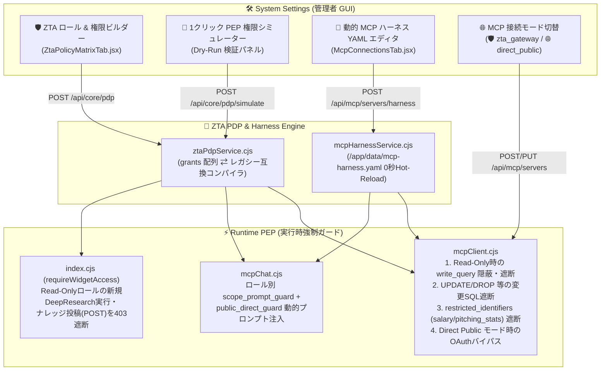

# ZTA ユニバーサル・ロール＆権限ビルダー & 動的 MCP ハーネス実装ウォークスルー (v1.2)

> [!IMPORTANT]
> **ペア・ドキュメント構成（設計計画書 ＆ 実装ウォークスルー）**
> 将来の機能拡張・仕様変更時に「なぜその設計にしたか（Plan）」と「どこにどう実装・検証されたか（Walkthrough）」をセットで参照できるよう、リポジトリ内の `docs/` ディレクトリに共通プレフィックス `zta_role_builder_and_mcp_harness_*` でペア保存しています。
> - 📘 **設計・実装計画書 (Plan)**: [zta_role_builder_and_mcp_harness_plan.md](file:///Users/minoru_inui/AI%20coder/MacOSUI/docs/zta_role_builder_and_mcp_harness_plan.md) （Artifact: [implementation_plan.md](file:///Users/minoru_inui/.gemini/antigravity/brain/2cc5b938-835e-4287-b881-2f1c347e908b/implementation_plan.md)）
> - 📗 **実装・検証記録 (Walkthrough)**: [zta_role_builder_and_mcp_harness_walkthrough.md](file:///Users/minoru_inui/AI%20coder/MacOSUI/docs/zta_role_builder_and_mcp_harness_walkthrough.md) （Artifact: [walkthrough.md](file:///Users/minoru_inui/.gemini/antigravity/brain/2cc5b938-835e-4287-b881-2f1c347e908b/walkthrough.md)）

---

## 1. アーキテクチャ全体像とデータフロー

今回の改修により、従来の「リソース×ロールの巨大なチェックボックス表」を廃止し、**すべてのリソース（MCP・ウィジェット・組織Pod・ナレッジ・システム管理）を共通の `PermissionGrant`（権限付与カード）で束ねるユニバーサル RBAC モデル**と、**コンテナ再デプロイ不要の `mcp-harness.yaml` 0秒ホットリロード機構**を確立しました。

---

## 2. 実装ファイル一覧と変更詳細

### 2.1 Phase 1: ZTA ユニバーサル・ロール＆権限ビルダー (`grants` モデル) & PEP 強制

| レイヤー | ファイル | 主な実装関数・シンボル | 変更内容 |
| :--- | :--- | :--- | :--- |
| **PDP エンジン** | [ztaPdpService.cjs](file:///Users/minoru_inui/AI%20coder/MacOSUI/server/services/ztaPdpService.cjs) | [`hydrateRolePolicy`](file:///Users/minoru_inui/AI%20coder/MacOSUI/server/services/ztaPdpService.cjs#L387-L569) [`compileRolePolicy`](file:///Users/minoru_inui/AI%20coder/MacOSUI/server/services/ztaPdpService.cjs#L575-L711) [`ROLE_PRESET_TEMPLATES`](file:///Users/minoru_inui/AI%20coder/MacOSUI/server/services/ztaPdpService.cjs#L716-L1197) [`evaluateRolesMcpGrant`](file:///Users/minoru_inui/AI%20coder/MacOSUI/server/services/ztaPdpService.cjs#L1202-L1254) [`inspectMcpToolCallAgainstGrant`](file:///Users/minoru_inui/AI%20coder/MacOSUI/server/services/ztaPdpService.cjs#L1259-L1305) [`evaluatePermissionSimulation`](file:///Users/minoru_inui/AI%20coder/MacOSUI/server/services/ztaPdpService.cjs#L1310-L1447) | ・4軸 (`resource_type`, `resource_id`, `operation_level`, `data_scope` + `constraints`) を持つ `grants` スキーマの双方向変換 ・人事部/部門長・NPBコミッショナー/球団編成部長・デジタル庁分析・DeepResearch閲覧専用など **11種類のロールテンプレート** を定義 ・MCPツール呼び出し時のSQL・禁止カラム検査およびPEPシミュレーター評価ロジックを実装 |
| **PDP API** | [corePlugins.cjs](file:///Users/minoru_inui/AI%20coder/MacOSUI/server/routes/corePlugins.cjs) | [`GET /api/core/pdp`](file:///Users/minoru_inui/AI%20coder/MacOSUI/server/routes/corePlugins.cjs#L90-L154) [`POST /api/core/pdp`](file:///Users/minoru_inui/AI%20coder/MacOSUI/server/routes/corePlugins.cjs#L160-L202) [`POST /api/core/pdp/simulate`](file:///Users/minoru_inui/AI%20coder/MacOSUI/server/routes/corePlugins.cjs#L207-L234) | ・ロール定義、テンプレート一覧、リソースカタログの一括返却と保存 ・1クリック PEP Dry-Run シミュレーション API の新設 |
| **MCP PEP** | [mcpClient.cjs](file:///Users/minoru_inui/AI%20coder/MacOSUI/server/mcpClient.cjs) | [`getAllMcpToolsForGemini`](file:///Users/minoru_inui/AI%20coder/MacOSUI/server/mcpClient.cjs#L420-L535) [`callMcpTool`](file:///Users/minoru_inui/AI%20coder/MacOSUI/server/mcpClient.cjs#L550-L685) | ・`operation_level === 'read_only'` のロールに対して更新系ツール (`write_query`, `drop_table` 等) をツール一覧から除外 ・実行時に変更系SQL (`UPDATE`/`INSERT`/`DELETE`/`DROP`) および `restricted_identifiers` (`salary`, `bonus`, `pitching_stats` 等) を含むクエリを検査・遮断し監査ログへ記録 |
| **Widget PEP** | [index.cjs](file:///Users/minoru_inui/AI%20coder/MacOSUI/server/index.cjs) | [`requireWidgetAccess`](file:///Users/minoru_inui/AI%20coder/MacOSUI/server/index.cjs#L2644-L2698) | ・`read_only` (`level: 'read'`) のウィジェット権限を持つユーザーが `POST /api/research`（新規DeepResearch実行）や `POST /api/knowledge`（ナレッジ新規登録）を呼び出した際に 403 で遮断し、`GET`（履歴閲覧・RAG対話）のみを許可 |
| **Role Builder UI** | [ZtaPolicyMatrixTab.jsx](file:///Users/minoru_inui/AI%20coder/MacOSUI/src/apps/SystemSettings/tabs/ZtaPolicyMatrixTab.jsx) [SystemSettings.jsx](file:///Users/minoru_inui/AI%20coder/MacOSUI/src/apps/SystemSettings.jsx) | [`ZtaPolicyMatrixTab`](file:///Users/minoru_inui/AI%20coder/MacOSUI/src/apps/SystemSettings/tabs/ZtaPolicyMatrixTab.jsx#L121-L725) | ・左ペイン（ロール一覧・新規ロール作成・1クリックテンプレート追加）＋右ペイン（`PermissionGrant` カードビルダー）の2ペインUIへ全面刷新 ・画面下部に **「🧪 ロール権限シミュレーター」** を統合 |

---

### 2.2 Phase 2 & Phase 3: 動的 MCP ハーネス (`mcp-harness.yaml`) 0秒ホットリロード & Direct Public 接続モード

| レイヤー | ファイル | 主な実装関数・シンボル | 変更内容 |
| :--- | :--- | :--- | :--- |
| **YAML ハーネス** | [mcpHarnessService.cjs](file:///Users/minoru_inui/AI%20coder/MacOSUI/server/services/mcpHarnessService.cjs) | [`initHarness`](file:///Users/minoru_inui/AI%20coder/MacOSUI/server/services/mcpHarnessService.cjs#L204-L229) [`saveAndHotReloadHarness`](file:///Users/minoru_inui/AI%20coder/MacOSUI/server/services/mcpHarnessService.cjs#L259-L278) [`classifyServerByHarness`](file:///Users/minoru_inui/AI%20coder/MacOSUI/server/services/mcpHarnessService.cjs#L289-L333) [`matchDomainsForPrompt`](file:///Users/minoru_inui/AI%20coder/MacOSUI/server/services/mcpHarnessService.cjs#L338-L351) | ・永続ボリューム `/app/data/mcp-harness.yaml` と DB (`MCP_HARNESS_YAML`) の自動同期・インメモリキャッシュ ・コンテナ再起動・再デプロイ不要の 0秒ホットリロード機構 |
| **MCP ルーティング** | [mcpServers.cjs](file:///Users/minoru_inui/AI%20coder/MacOSUI/server/routes/mcpServers.cjs) [mcpChat.cjs](file:///Users/minoru_inui/AI%20coder/MacOSUI/server/routes/mcpChat.cjs) | [`GET/POST /api/mcp/servers/harness`](file:///Users/minoru_inui/AI%20coder/MacOSUI/server/routes/mcpServers.cjs#L57-L108) [`mcpChat POST /`](file:///Users/minoru_inui/AI%20coder/MacOSUI/server/routes/mcpChat.cjs#L350-L438) | ・`mcp_servers` テーブルへの `connection_mode` (`zta_gateway` / `direct_public` / `builtin_local`) および `domain_key` カラム自動マイグレーション ・プロンプト発火時のドメイン別 `routing_instruction`、ロール別 `scopePromptGuard`、および `direct_public` サーバー接続時の `public_direct_guard`（機密・PII送信防止ガード）の動的注入 |
| **MCP 管理 UI** | [McpConnectionsTab.jsx](file:///Users/minoru_inui/AI%20coder/MacOSUI/src/apps/SystemSettings/tabs/McpConnectionsTab.jsx) | [`McpConnectionsTab`](file:///Users/minoru_inui/AI%20coder/MacOSUI/src/apps/SystemSettings/tabs/McpConnectionsTab.jsx#L14-L690) | ・サーバー追加/編集モーダルに `🛡️ ZTA Gateway 経由 (OAuth A2A)` と `🌐 Direct Public (公開データ直接接続)` の切替スイッチを追加（Direct Public 選択時は OAuth 入力欄を自動省略） ・「🛡️ Harness & Rules (YAML Hot-Reload)」サブタブに `mcp-harness.yaml` ライブエディタと **「⚡ 0秒ホットリロード保存」** ボタンを追加 |

---

## 3. 実機・コンテナ検証結果 (`macosui-local`)

ローカル Docker コンテナ（`macosui-local` / `http://localhost:8080`）上で、以下5つの代表的な権限・データスコープ検証シナリオを実行し、すべて期待通りに `PERMIT` / `DENY` 判定されることを確認しました。

| # | 検証対象ロール | リソース種別 / ID | 実行アクション / クエリ例 | 判定結果 | PEP 判定理由ログ |
| :-: | :--- | :--- | :--- | :-: | :--- |
| **1** | `🐯 NPB 球団編成部長` (`npb_team_mgr`) | `mcp_server` (`#5` NPB 管理者用MCP) | `read_query`: `SELECT player_name, batting_avg FROM batting_stats WHERE team = 'Hanshin'` | **✅ PERMIT** | `許可 (operation_level: read_only, data_scope: department_pod)` |
| **2** | `🐯 NPB 球団編成部長` (`npb_team_mgr`) | `mcp_server` (`#5` NPB 管理者用MCP) | `write_query`: `UPDATE batting_stats SET home_runs = 99` | **🚫 DENY** | `ロールの制約 (blocked_tools) によりツール「write_query」の実行は禁止されています。` |
| **3** | `🐯 NPB 球団編成部長` (`npb_team_mgr`) | `mcp_server` (`#5` NPB 管理者用MCP) | `read_query`: `SELECT * FROM pitching_stats` | **🚫 DENY** | `ロールのデータスコープ制約 (department_pod) により、機密指定された識別子・テーブル・カラム「pitching_stats」へのアクセスは ZTA PEP によりブロックされました。` |
| **4** | `🔬 DeepResearch 閲覧専用` (`researcher_viewer`) | `widget` (`deep-research`) | `execute` (新規 DeepResearch 調査ジョブの起動) | **🚫 DENY** | `このロールは「参照のみ (read_only)」のため、過去履歴の閲覧は可能ですが、新規ジョブ実行 (execute) は ZTA PEP によりブロックされました。` |
| **5** | `🔬 DeepResearch 閲覧専用` (`researcher_viewer`) | `widget` (`deep-research`) | `view_history` (過去調査レポートの閲覧) | **✅ PERMIT** | `ウィジェット「deepresearch」の閲覧・参照 (現在の権限レベル: read) が許可されています。` |

---

## 4. 今後の改修・拡張時のメンテナンスガイド

将来、新しいガジェット（Widget）や新しい MCP サーバー、あるいは新しいデータスコープ軸を追加する際は、以下の箇所のみを編集することでシステム全体に反映されます。

1. **新しい MCP ドメインやルーティング指示を追加する場合（コード変更・再デプロイ不要）**:
   - System Settings → **「🧩 ウィジェット管理 & ストア」** → **「MCP Agent」** → **「🛡️ Harness & Rules (YAML Hot-Reload)」** を開き、`domains:` セクションに新しいドメイン定義を追加して **「⚡ 0秒ホットリロード保存」** をクリックします（実体ファイル `/app/data/mcp-harness.yaml` に永続化されます）。
2. **新しいプリセットロールや権限軸を追加する場合**:
   - バックエンド: [server/services/ztaPdpService.cjs](file:///Users/minoru_inui/AI%20coder/MacOSUI/server/services/ztaPdpService.cjs) の [`ROLE_PRESET_TEMPLATES`](file:///Users/minoru_inui/AI%20coder/MacOSUI/server/services/ztaPdpService.cjs#L716-L1197) および [`inspectMcpToolCallAgainstGrant`](file:///Users/minoru_inui/AI%20coder/MacOSUI/server/services/ztaPdpService.cjs#L1259-L1305)
   - フロントエンド: [src/apps/SystemSettings/tabs/ZtaPolicyMatrixTab.jsx](file:///Users/minoru_inui/AI%20coder/MacOSUI/src/apps/SystemSettings/tabs/ZtaPolicyMatrixTab.jsx)
